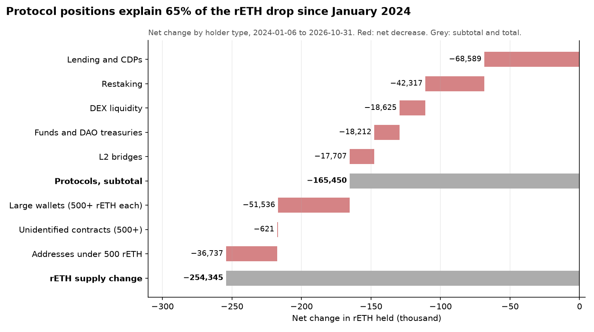

# rETH Competitiveness and Commission Study

How much does rETH demand respond to its yield gap against stETH, and what would a 14%, 12% or 10% fee mean for rETH holders, node operators and RPL voters?

This repository answers that with public data only, and reruns itself every week.

> **Status:** work in progress. Numbers in `reth_study/` and `results/` are produced by the workflow below and may change as the method is reviewed. Nothing here is financial advice.

## Key findings so far

Data from 6 January 2024 to 31 October 2026. The CSV files below always hold the latest run.

- **Who left.** rETH supply fell by 254,300. Protocol positions explain 65% of the drop: lending and CDPs −68,600, restaking −42,300, DEX liquidity −18,600, funds and DAO treasuries −18,200 and L2 bridges −17,700. The 58,655 addresses that each moved less than 500 rETH, net, explain 14%.
- **Largest exits and gains.** EigenLayer −50,000, Spark −33,600, Prisma −25,200, Balancer −14,700, the Arbitrum bridge −13,800 and Nexus Mutual −10,900. Symbiotic +7,700, Liquity V2 +5,600 and Morpho +3,300.
- **Since Saturn 1** (18 February 2026, measured from the first weekly snapshot after it), supply fell by 34,200. Funds and DAO treasuries are the largest part of it (−13,300).
- **Lending.** The share of all rETH deposited on Spark fell from 6.6% to 1.2%. On Aave v3 it rose from 7.8% to 11.3%. Across both markets, the median looping spread (staking yield minus the WETH borrow rate) was 14 bps for rETH and 41 bps for wstETH, and the 14% vs 10% fee difference accounts for about 40% of that gap.
- **Demand response.** Week to week, rETH flows show no reliable response to the yield gap with stETH: p = 0.92 at a one-week lag, and p = 0.03 at four weeks, which becomes 0.12 after correcting for the four lags tested.
- **Monthly report.** The first one, for October 2026, is in [reports/2026-10.md](reports/2026-10.md): who moved rETH that month, who redeemed it, and why.



Discussion and feedback: [forum thread](https://dao.rocketpool.net/t/is-reths-fee-costing-it-demand-a-data-study-plan-first-numbers-feedback-welcome/4116).

## What it does

The notebook [`reth_study_v2.ipynb`](reth_study_v2.ipynb) runs seven steps:

1. **Block number for each week** from January 2024 (DefiLlama coins API).
2. **On-chain series** at each block, read from an Ethereum archive node: rETH supply and exchange rate, and stETH's exchange rate as benchmark.
3. **Market prices** of rETH and ETH (DefiLlama coins API).
4. **Weekly panel**: net APR of rETH and stETH, yield gap, net rETH flows, market premium or discount.
5. **Self-check** against published rETH supply figures. The run stops if they disagree by more than 1%.
6. **Demand response**: weekly flows regressed on the lagged yield gap, the premium, the ETH price change and a Saturn 1 marker, with autocorrelation-robust errors. A second version adds stETH's net flows as a market-wide control, and p-values across the four lags are Holm-adjusted.
7. **Fee scenarios**: a 12-month projection for 14%, 12% and 10% fees, with the 95% range of the demand response.

## Outputs

| File | Content |
| --- | --- |
| `reth_study/weekly_panel.csv` | The weekly dataset behind every number |
| `reth_study/demand_response.csv` | Regression results for lags 1 to 4 and a robustness check |
| `reth_study/fee_scenarios.csv` | Scenario projections |
| `reth_study/quarterly.csv` | Quarterly yield gap, the part the fee explains, and flows |
| `reth_study/holders_by_category.csv` | Who is leaving: the net rETH change split by holder type (restaking, lending and CDPs, DEX liquidity, L2 bridges, funds and DAO treasuries, large wallets, everyone else). Each column adds up exactly to the supply change |
| `reth_study/holders_by_entity.csv` | Net change per identified protocol or treasury, since January 2024 and since Saturn 1 |
| `reth_study/holders_*.csv` (other) | Top leavers and gainers with balances at both ends, concentration, where the top leavers sent their rETH, worst weeks, unlabelled large addresses, and how each week was fetched and checked ([`analysis/holders.py`](analysis/holders.py)) |
| `analysis/labels.csv` | Who each identified address is, and the evidence for it |
| `reth_study/holders_month*.csv` | The last complete month: its window and supply change, and every address that moved 1,000 rETH or more, with balances at both ends |
| `reports/<YYYY-MM>.md` | The monthly rETH Demand Monitor report, with its chart ([`analysis/report.py`](analysis/report.py)). The section on why large moves happened is written by hand in `reports/notes/` |
| `reth_study/lending_*.csv` | rETH and wstETH supplied on Aave v3 and Spark, the WETH borrow rate, the looping spread, and whether supply follows it ([`analysis/lending.py`](analysis/lending.py)) |
| `reth_study/chart_*.png` | Charts |
| `results/reth_study_v2_executed.ipynb` | The notebook as last executed, with outputs |

## How it runs

- **GitHub Actions** ([`.github/workflows/study.yml`](.github/workflows/study.yml)) first runs the offline test, then executes the notebook on live data and commits the results. It runs on every change, on demand, and every Sunday to add the new week.
- **Archive node:** the notebook tries free public endpoints first. If none serves old blocks, add a free Alchemy key as the repository secret `ALCHEMY_KEY`.
- **Holder analysis** ([`.github/workflows/holders.yml`](.github/workflows/holders.yml)) runs separately: on changes to `analysis/`, on demand and monthly. It probes about 40 public Ethereum endpoints, downloads every rETH transfer week by week from those that answer, and accepts a week only if its mints minus burns equal the supply change in the weekly panel. A free `ETHERSCAN_KEY` secret is an optional fallback.
- **Lending analysis** ([`.github/workflows/lending.yml`](.github/workflows/lending.yml)) runs on the 3rd of each month.
- **Monthly report** ([`.github/workflows/report.yml`](.github/workflows/report.yml)) runs after both, on the 3rd of each month, and writes `reports/<YYYY-MM>.md` for the last complete month. Committing a note to `reports/notes/<YYYY-MM>.md` rebuilds the report with it.
- **Run it yourself:** open the notebook in Google Colab and choose *Run all*, or locally:

```bash
pip install -r requirements.txt
jupyter nbconvert --to notebook --execute reth_study_v2.ipynb --output-dir results
```

## Test

`tests/test_notebook_v2.py` runs the whole notebook offline against a synthetic market in which flows respond to the yield gap with a known slope. It passes only if the regression recovers that slope. `tests/test_holders.py` runs the holder analysis against a synthetic history with a known answer, served by fake sources that limit ranges, cap results, drop data silently or fail. `tests/test_lending.py` checks that the lending regression recovers a known slope, and `tests/test_report.py` checks the monthly report against outputs with known numbers.

```bash
python tests/test_notebook_v2.py
python tests/test_holders.py
python tests/test_lending.py
python tests/test_report.py
```

## Context

- Forum thread for this study: [Is rETH's fee costing it demand?](https://dao.rocketpool.net/t/is-reths-fee-costing-it-demand-a-data-study-plan-first-numbers-feedback-welcome/4116)
- Forum discussion that motivated the study: [Increase rETH demand by reducing the voter share from 9% to 5%](https://dao.rocketpool.net/t/increase-reth-demand-by-reducing-the-voter-share-from-9-to-5-sentiment-poll/3969)
- Fee labels used in the comparison come from DefiLlama's LSD list ([source](https://github.com/DefiLlama/yield-server/blob/master/src/handlers/triggerLSDRates.js)).

## Disclosure

Written by Nishikawa with AI assistance (Claude). The author's RPL and rETH holdings will be stated in the forum post that presents the findings.

## License

[MIT](LICENSE)
