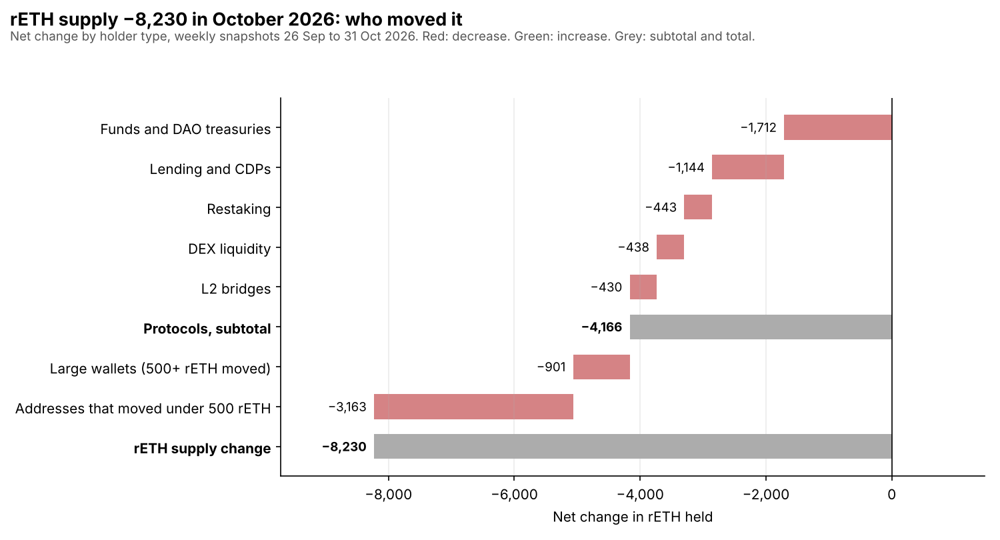

# rETH Demand Monitor: October 2026

Who holds rETH, who left and why, from weekly on-chain snapshots between 26 September 2026 and 31 October 2026 (5 weeks). The tables are generated from the [open repository](https://github.com/NishikawaButterfly/reth-competitiveness-study); section 2 is written by hand. Sources and checks are listed at the end.

## Summary

- **Supply:** rETH supply went from 316,235 to 308,005 (−8,230 rETH, −2.6%). The ETH backing rETH changed by −2.4% and stETH's by −0.9%.
- **Redemptions:** 9,322 rETH burned for ETH and 1,092 minted in 5 weeks, or 1,864 and 218 a week, against 1,685 and 768 a week over the previous 6 months. The week to 24 October 2026 burned 5,475 rETH, 59% of the month's burns. The largest burner was an unlabelled contract [0x1f2f10…6df387](https://etherscan.io/address/0x1f2f10d1c40777ae1da742455c65828ff36df387) (1,822 rETH).
- **Largest net decreases:** Nexus Mutual −1,712, Aave v3 −1,018, Balancer −423 (identified protocols and treasuries); other addresses, each moving under 500 rETH, −2,661 in total.
- **Wallet-to-wallet transfers:** 2 transfers moved 2,354 rETH to new addresses, possibly the same owners'. They do not change the supply.
- **Lending:** rETH deposited on Aave v3 and Spark went from 39,634 to 38,551. Looping rETH paid a median +13 bps on Aave v3 and +25 bps on Spark, −11 bps against wstETH on the same markets (4-week average staking yields).
- **Yield:** rETH's APR over the month was 2.11% and stETH's 2.65%, a gap of −54 bps (Jul −4, Aug −2, Sep −9 bps in the months before). Without the week flagged in section 4 the gap was −19 bps; section 2 explains that week.

## 1. Who moved rETH

| Holder type | Net change (rETH) | Addresses |
| --- | ---: | ---: |
| Restaking | −443 | 2 |
| Lending and CDPs | −1,150 | 5 |
| DEX liquidity | −934 | 8 |
| L2 bridges | −431 | 4 |
| Funds and DAO treasuries | −1,712 | 1 |
| Large wallets (each moved 500+ rETH) | −901 | 7 |
| Other addresses (each moved under 500 rETH) | −2,661 | 2,225 |
| **Total (= supply change)** | **−8,230** | |

Rows are rounded, so they may not add up exactly to the total.

Within other addresses, those that moved 50 rETH or more were 47 wallets (−1,601), 8 Safe multisigs (−196); everyone else came to −864.

**Identified protocols and treasuries**

| Entity | Type | Net change | Holdings, start → end | Change in holdings | Since Saturn 1 | Since January 2024 |
| --- | --- | ---: | ---: | ---: | ---: | ---: |
| Nexus Mutual | Funds and DAO treasuries | −1,712 | 4,219 → 2,507 | −41% | −5,741 | −10,851 |
| Aave v3 | Lending and CDPs | −1,018 | 35,799 → 34,781 | −2.8% | +1,379 | −8,200 |
| Balancer | DEX liquidity | −423 | 1,170 → 747 | −36% | −874 | −14,728 |
| EigenLayer | Restaking | −338 | 3,913 → 3,576 | −8.6% | −1,764 | −50,041 |
| rETH/WETH DEX pools | DEX liquidity | −282 | 300 → 18 | −94% | −51 | −533 |
| Arbitrum bridge | L2 bridges | −247 | 4,378 → 4,130 | −5.6% | −1,958 | −13,848 |
| Uniswap v4 | DEX liquidity | −158 | 248 → 91 | −64% | +29 | +91 |
| Optimism bridge | L2 bridges | −110 | 2,495 → 2,385 | −4.4% | −912 | −3,454 |
| Symbiotic | Restaking | −105 | 7,829 → 7,724 | −1.3% | −1,681 | +7,724 |
| Base bridge | L2 bridges | −74 | 1,936 → 1,862 | −3.8% | −667 | +989 |
| Liquity V2 | Lending and CDPs | −72 | 5,647 → 5,575 | −1.3% | −361 | +5,575 |
| Spark | Lending and CDPs | −65 | 3,794 → 3,729 | −1.7% | −10,922 | −33,602 |
| osETH/rETH pool | DEX liquidity | −56 | 2,036 → 1,979 | −2.8% | −227 | −324 |
| TryLSD pool | DEX liquidity | −15 | 39 → 24 | −38% | −7 | −1,196 |
| Morpho | Lending and CDPs | +11 | 3,257 → 3,269 | +0.4% | +3,269 | +3,269 |

**Every address that moved 1,000 rETH or more**

| Who | Holder type | Net change | Balance at start | Balance at end | Main counterparty |
| --- | --- | ---: | ---: | ---: | --- |
| Nexus Mutual capital pool (new) ([0xcafea9…1697cb](https://etherscan.io/address/0xcafea91714e55756c125b509274ede9bc91697cb)) | Funds and DAO treasuries | −1,712 | 4,219 | 2,507 | 100% sent to contract SwapOperator ([0xcafea5…f06eb8](https://etherscan.io/address/0xcafea501b78175f178b899625f06bc618ef06eb8)) |
| Unlabelled wallet [0x98107a…104cc7](https://etherscan.io/address/0x98107accd605e72a96de0013344d3b3981104cc7) | Large wallets (each moved 500+ rETH) | −1,294 | 1,294 | 0 | 100% sent to a wallet [0x27364f…3e3a87](https://etherscan.io/address/0x27364fc16962c187f3ea7d0b01190c3ae73e3a87) (wallet-to-wallet transfer) |
| Unlabelled wallet [0x63fc27…251db3](https://etherscan.io/address/0x63fc27188ba91c75bd1ee4f807fdbce6d3251db3) | Large wallets (each moved 500+ rETH) | −1,126 | 1,126 | 0 | 100% sent to Aave v3 aEthrETH |
| Unlabelled wallet [0x99c7f0…c42ed4](https://etherscan.io/address/0x99c7f0a8533649e7cd5d48868a838d9ac4c42ed4) | Large wallets (each moved 500+ rETH) | −1,060 | 1,060 | 0 | 100% sent to a wallet [0x71056a…14670f](https://etherscan.io/address/0x71056aaf318db9726c84f0fabe223c215a14670f) (wallet-to-wallet transfer) |
| Aave v3 aEthrETH ([0xcc9ee9…c2630f](https://etherscan.io/address/0xcc9ee9483f662091a1de4795249e24ac0ac2630f)) | Lending and CDPs | −1,018 | 35,799 | 34,781 | 20% sent to a wallet [0x440888…f7fac4](https://etherscan.io/address/0x440888714a6afed60ff44e9975a96e6a36f7fac4) |
| Unlabelled wallet [0x71056a…14670f](https://etherscan.io/address/0x71056aaf318db9726c84f0fabe223c215a14670f) | Large wallets (each moved 500+ rETH) | +1,060 | 0 | 1,060 | 100% received from a wallet [0x99c7f0…c42ed4](https://etherscan.io/address/0x99c7f0a8533649e7cd5d48868a838d9ac4c42ed4) (wallet-to-wallet transfer) |
| Unlabelled wallet [0x27364f…3e3a87](https://etherscan.io/address/0x27364fc16962c187f3ea7d0b01190c3ae73e3a87) | Large wallets (each moved 500+ rETH) | +1,294 | 0 | 1,294 | 100% received from a wallet [0x98107a…104cc7](https://etherscan.io/address/0x98107accd605e72a96de0013344d3b3981104cc7) (wallet-to-wallet transfer) |

**Largest redemptions (rETH burned for ETH)**

| Who | Burned | Share of the month's burns | Week with most burning | Main source of its rETH | Burned on arrival |
| --- | ---: | ---: | --- | --- | ---: |
| Unlabelled contract [0x1f2f10…6df387](https://etherscan.io/address/0x1f2f10d1c40777ae1da742455c65828ff36df387) | 1,822 | 20% | 24 October 2026 (999) | 48% from rETH/WETH pool (0x553e9c) | 100% |
| Contract MainnetSettler ([0x0cef32…e53cd5](https://etherscan.io/address/0x0cef320d0c5793ade37964e2661a033771e53cd5)) | 895 | 10% | 24 October 2026 (696) | 38% from a wallet [0x9d7f5b…e5367f](https://etherscan.io/address/0x9d7f5b1e74e14654ecd6e13a50807b244de5367f) | 100% |
| Unlabelled contract [0x8f10b4…13f996](https://etherscan.io/address/0x8f10b468b06c6fd214b65f87778827f7d113f996) | 878 | 9% | 24 October 2026 (755) | 20% from contract EIP7702Proxy ([0x3b15ce…9f89cb](https://etherscan.io/address/0x3b15cec2d922ab0ef74688bcc1056461049f89cb)) | 100% |
| Unlabelled Safe multisig [0xca14fd…0e8faf](https://etherscan.io/address/0xca14fd171214dd09da5cc1da5966c375380e8faf) | 544 | 6% | 24 October 2026 (544) | 53% from Aave v3 aEthrETH | 0% |
| Unlabelled contract [0xc432de…34ba98](https://etherscan.io/address/0xc432de704b300f131b551458a640b9b9c034ba98) | 390 | 4% | 24 October 2026 (184) | 74% from rETH/WETH pool (0x553e9c) | 100% |

Main source: the address that sent it the most rETH during the month. Burned on arrival: the share of what it burned that it received in the same transaction, as when rETH is bought on a market or routed from a seller and redeemed at once.

Largest mints: Unlabelled wallet [0xce8d03…1022a6](https://etherscan.io/address/0xce8d037748fa151a1ca6d18138066ce61d1022a6) 231, Unlabelled wallet [0x493841…e4bbed](https://etherscan.io/address/0x4938412d8cac27cf2a9e1a900c881cc437e4bbed) 191, Unlabelled Safe multisig [0xde53bc…e0ec99](https://etherscan.io/address/0xde53bcda6527d2aa15ec733352c8d393c2e0ec99) 146.

## 2. Why it happened

**Redemptions drove the month.** In five weeks, 9,322 rETH were burned for ETH and 1,092 minted: 1,864 burned and 218 minted a week, against 1,685 and 768 a week over the previous six months. Burning ran about 11% above that six-month pace, and at two to three times its pace in August and September. Minting averaged under 250 rETH a week from August to October (245, 91 and 218 a week), then picked up to 396 and 285 in the last two weeks of October as the discount closed.

**One week, mostly bought and redeemed at once.** The week to 24 October burned 5,475 rETH, 59% of the month's burns and 62% of the supply drop. Eight of the ten largest redeemers burned rETH in the same transaction they received it: 4,906 rETH, 53% of all rETH burned this month. Four of them, including the largest (1,822), got the largest part of it from the same rETH/WETH pool (48% to 99% each), the pattern of arbitrage: buy below the protocol rate and redeem at once. Two look like routed sales: MainnetSettler, the name of 0x Protocol's settlement contract (895), and a contract fed by CoW Protocol's settlement contract (197). The other two (878 and 244) received the largest part from EIP-7702 smart accounts, and why is not yet clear. Only two of the ten redeemed rETH they already held: a Safe that withdrew 544 rETH from Aave and a wallet that redeemed 264. rETH was 0.31% below its protocol rate in the 17 October price snapshot and back at par (+0.02%) on 24 October.

**Nexus Mutual (−1,712).** On 15 October, Nexus Mutual's capital pool moved 1,712 rETH to its SwapOperator contract, which sold all of it through CoW Protocol in 52 orders within about half an hour ([its rETH transfers](https://etherscan.io/address/0xcafea501b78175f178b899625f06bc618ef06eb8#tokentxns)). In June 2024 Nexus Mutual proposed letting its Investment Committee convert stETH and rETH back to ETH to keep cash-like assets on hand ([NMPIP 225](https://forum.nexusmutual.io/t/nmpip-225-divestment-framework/1459)). It held 2,507 rETH at the end of October, down from 13,358 in January 2024.

**rETH's own yield dipped.** rETH's weekly APR fell to 2.02% and then 1.82% in the weeks to 17 and 24 October; 1.82% was its lowest weekly reading since January. Over the four weeks to 24 October the gap with stETH was −19 bps, wider than in July to September (−2 to −9 bps a month). The cause is not yet identified. The November report will check the timing of rETH's rate updates and how much ETH sat unstaked in the deposit pool.

**Why the month's gap looks wider still (−54 bps).** One Lido oracle report on 30 October (12:22 UTC, block 26,305,541) raised stETH's exchange rate by about 6.4 times its average daily growth over the six days before. It included 3,795 ETH of execution-layer rewards; the report the day before had 15 ETH. This data does not show whether that was a one-off windfall or rewards paid out late. If it was a one-off, the −19 bps over the four weeks before it is the better measure of October. If it paid out rewards earned earlier, part of it belongs to earlier weeks, and the gap in those weeks was wider than measured.

**Markets.** Balancer's rETH fell by 36% (1,170 to 747) and EigenLayer's by 8.6% (3,913 to 3,576). Aave v3 lost 1,018 net (−2.8%): its largest withdrawals went to a wallet (974 rETH), an EIP-7702 account (847) and the Safe above (544), while one wallet deposited 1,126. Spark barely moved (−65) after a single 1,584 rETH withdrawal in September. On DEXes, rETH liquidity thinned: the two rETH/WETH pools, the arbitrageurs' main source, fell from 300 to 18 rETH and Uniswap v4's PoolManager from 248 to 91.

**New labels this month.** Reviewing the other-addresses bucket turned up four DEX pools that lost 496 rETH between them in October: two rETH/WETH pools, Uniswap v4's PoolManager and an osETH/rETH pool. They are now labelled as DEX liquidity, together with two L2 token bridges and Radiant's rETH market, with the evidence for each in labels.csv. The tables in this report use the new labels, so the figures since January 2024 in section 5 differ slightly from earlier posts.

**Wallet-to-wallet transfers.** Two wallets moved all their rETH (1,294 and 1,060) to new addresses, possibly their own. That does not change the supply.

**What to watch in November.** Whether minting keeps recovering from its August to October average of under 250 rETH a week. What Nexus Mutual does with its remaining 2,507 rETH. Whether rETH's mid-October dip in weekly APR repeats, since it widened the gap with stETH on its own. How much ETH was available for redemptions when burning picked up; the November report adds it.

## 3. Lending markets

| Market | rETH deposited, start → end | Share of all rETH | wstETH deposited, start → end | Median loop spread, rETH | Median loop spread, wstETH | Median weekly gap |
| --- | ---: | ---: | ---: | ---: | ---: | ---: |
| Aave v3 | 35,839 → 34,821 | 11.3% | 777,819 → 792,678 | +13 bps | +29 bps | −11 bps |
| Spark | 3,795 → 3,730 | 1.2% | 1,105,596 → 1,232,490 | +25 bps | +34 bps | −11 bps |

Loop spread: staking yield (4-week average) minus the WETH variable borrow rate on the same market. The last column is the median of each week's rETH spread minus wstETH spread; both borrow the same WETH, so that difference is the staking yield gap. Deposits are the market's aToken supply, which includes any rETH lent out, so they can sit slightly above the rETH balance in section 1.

At the 31 October 2026 snapshot, Spark's WETH borrow rate was 4.67%; at that rate loops would pay −260 bps on rETH and −196 bps on wstETH. The rate is read at one block, not averaged over the week.

## 4. Supply and yield

| Measure | Value |
| --- | --- |
| rETH supply, start → end | 316,235 → 308,005 (−8,230) |
| Burned / minted in the month | 9,322 / 1,092 (1,864 / 218 a week) |
| Burned / minted a week, previous 6 months | 1,685 / 768 |
| rETH APR over the month, from its exchange rate | 2.11% |
| stETH APR over the month, from its exchange rate | 2.65% |
| Gap, rETH − stETH | −54 bps |
| Gap without the flagged week | −19 bps |
| rETH weekly APR, in order | 2.19%, 2.18%, 2.02%, 1.82%, 2.24% |
| Weekly gaps, in order (bps) | −6, −6, −21, −40, −192 |
| Gap in the months before (bps) | Jul −4, Aug −2, Sep −9 |
| rETH market price vs protocol rate, weekly snapshots (DefiLlama prices) | −0.25%, −0.18%, −0.31%, +0.02%, −0.01% |

Check before reading the gap: stETH's weekly APR in the week to 31 October 2026 was 4.16%, against a monthly median of 2.24%. Weekly rates move with oracle timing and one-off events, and a week like this also moves the monthly figure.

## 5. Context

- From 6 January 2024 to 31 October 2026, rETH supply changed by −254,345; protocol positions account for 65% of it.
- Over the same period the ETH backing rETH changed by −41.2% and stETH's by +4.7%.
- From the first weekly snapshot after Saturn 1 (21 February 2026) to 31 October 2026: −34,240 rETH.

## Data, sources and checks

- **Sources:** rETH Transfer events, balances and exchange rates read from public Ethereum RPC endpoints (archive state); stETH's rate from the stETH contract; market prices from DefiLlama; contract names from Blockscout and Sourcify; protocol labels with the evidence for each in [analysis/labels.csv](https://github.com/NishikawaButterfly/reth-competitiveness-study/blob/b1e84919dfa25816048d8b42de4fccc9a7f94c7c/analysis/labels.csv).
- **Check:** for each of the 5 weeks, mints minus burns in the Transfer events equal the change in rETH's totalSupply read from the contract at the two snapshot blocks. All weeks passed. Balances of listed addresses are read from archive state at both ends.
- **Files** at commit b1e8491: [holders_month.csv](https://github.com/NishikawaButterfly/reth-competitiveness-study/blob/b1e84919dfa25816048d8b42de4fccc9a7f94c7c/reth_study/holders_month.csv), [holders_by_category.csv](https://github.com/NishikawaButterfly/reth-competitiveness-study/blob/b1e84919dfa25816048d8b42de4fccc9a7f94c7c/reth_study/holders_by_category.csv), [holders_by_entity.csv](https://github.com/NishikawaButterfly/reth-competitiveness-study/blob/b1e84919dfa25816048d8b42de4fccc9a7f94c7c/reth_study/holders_by_entity.csv), [holders_month_movers.csv](https://github.com/NishikawaButterfly/reth-competitiveness-study/blob/b1e84919dfa25816048d8b42de4fccc9a7f94c7c/reth_study/holders_month_movers.csv), [holders_month_counterparties.csv](https://github.com/NishikawaButterfly/reth-competitiveness-study/blob/b1e84919dfa25816048d8b42de4fccc9a7f94c7c/reth_study/holders_month_counterparties.csv), [holders_month_mint_burn.csv](https://github.com/NishikawaButterfly/reth-competitiveness-study/blob/b1e84919dfa25816048d8b42de4fccc9a7f94c7c/reth_study/holders_month_mint_burn.csv), [holders_month_others.csv](https://github.com/NishikawaButterfly/reth-competitiveness-study/blob/b1e84919dfa25816048d8b42de4fccc9a7f94c7c/reth_study/holders_month_others.csv), [holders_weeks.csv](https://github.com/NishikawaButterfly/reth-competitiveness-study/blob/b1e84919dfa25816048d8b42de4fccc9a7f94c7c/reth_study/holders_weeks.csv), [lending_panel.csv](https://github.com/NishikawaButterfly/reth-competitiveness-study/blob/b1e84919dfa25816048d8b42de4fccc9a7f94c7c/reth_study/lending_panel.csv), [weekly_panel.csv](https://github.com/NishikawaButterfly/reth-competitiveness-study/blob/b1e84919dfa25816048d8b42de4fccc9a7f94c7c/reth_study/weekly_panel.csv).

Not financial advice.
